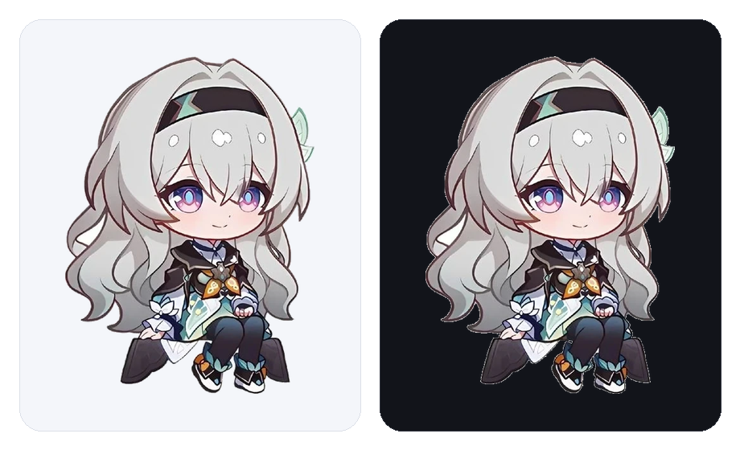
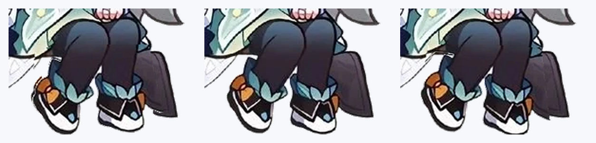

# dsh-firefly · 流萤桌宠

给 **DeepSeek Harness Web 界面**用的互动桌宠：一只浮在界面上的小流萤，点一下会理你，还会说些话，可以随手拖到任何角落。



它就是一个普通的 DSH 插件 bundle：不需要构建、没有运行时依赖、不联网、也不修改 Harness 源码。插件渲染在 `shell.overlay` 槽位里，浮在界面上方，但不会挡住其他地方的点击。

> 状态：v1.3.0。清单、overlay 契约、交互状态机、分层形象（晃腿）、图片处理、素材内联同步与卸载路径都有测试覆盖；能力边界见[验证范围](#验证范围)。

---

## 特性

| | |
|---|---|
| **内置形象** | 角色图以透明 WebP 打包，并内联进客户端模块，任意尺寸都不发网络请求。浮动、弹跳、转圈等动效由 CSS 围着图片做。 |
| **安静时晃腿** | 没事的时候双腿会绕着胯摆动（±3.2°）——腿是单独一层，身体其他部分不会被拉扯变形。拖拽或触发反应时自动停。 |
| **点击互动** | 点一下（或按 Enter/空格）会弹一下并冒出一句台词；双击触发更特别的反应。 |
| **随手拖拽** | 拖到哪都行，位置按窗口比例记住，缩放窗口、重启应用都还在原地。 |
| **跟着界面语言** | 台词随 Harness 界面语言切换中英文。 |
| **会犯困** | 45 秒没人理就困了（变暗、冒 zzz），点一下立刻醒。 |
| **右键设置** | 大小（120–320 px）、不透明度（35–100 %）、去白底、恢复默认、隐藏（留一个边缘小标签随时叫回来）。 |
| **换成你自己的立绘** | 上传任意图片，在浏览器内缩小、可选自动去白底，白底贴纸也能干净地落在浅色与深色主题上。 |
| **不碍事** | overlay 根节点保持 `pointer-events: none`，只有桌宠本体、气泡和菜单响应事件；尊重 `prefers-reduced-motion`。 |
| **全本地** | 位置和图片只存在 `localStorage`，不会上传到任何地方。 |



---

## 安装

1. 侧边栏打开 **插件（Plugins）**。
2. 点 **Add plugin** 旁的箭头，选择 **Install a third-party plugin**（安装第三方插件）。
3. 填其中之一：
   - **本地目录** —— 你克隆/解压出来的仓库目录。
   - **Git 仓库** —— `https://github.com/OWNER/dsh-firefly.git`（把 `OWNER` 换成实际账号，见 [`docs/PUBLISHING.md`](docs/PUBLISHING.md)）。
4. 确认 **dsh-firefly** bundle 处于**开启**状态。

她会出现在界面右下角。如果没出现，重启一次 DeepSeek Harness 让新的客户端模块加载。

卸载：**插件 → dsh-firefly → Remove**，然后重启。

### 环境要求

- 带 Web 界面的 DeepSeek Harness（`0.2.x` 客户端包）。
- 任意 Chromium 内核，桌面版自带即可。

---

## 使用

| 操作 | 结果 |
|---|---|
| 单击 / <kbd>Enter</kbd> / <kbd>空格</kbd> | 弹一下，说一句话。 |
| 双击 | 特殊反应（转个圈 + 一句少见台词）。 |
| 拖拽 | 移动位置，并记住。 |
| 右键 | 打开设置菜单。 |
| <kbd>Esc</kbd> | 关闭菜单。 |

### 设置菜单

| 控件 | 默认 | 范围 | 说明 |
|---|---|---|---|
| 大小 | 180 px | 120–320 | 渲染宽度，高度按比例。 |
| 不透明度 | 100 % | 35–100 | 想让她安静一点就调低。 |
| 去除白底 | 开 | 开 / 关 | **只对之后上传的图片**生效。 |
| 选择 / 更换图片 | — | — | 任意 `image/*`，会缩到 ≤640 px 并以 PNG 保存。 |
| 换回内置图片 | — | — | 丢弃上传的图片。 |
| 恢复默认 | — | — | 位置、大小、不透明度、形象一起还原。 |
| 隐藏桌宠 | — | — | 右侧留一个小标签，点一下叫她回来。 |

### 换成你自己的立绘

点 **选择图片** 选一张图，她会换上皮囊，但浮动、弹跳、拖拽的手感完全一样。

二次元贴纸图通常带白底。勾着 **去除白底** 时，插件会从图片四边做连通洪水填充，把与边缘相连的白色变成透明——只清除边缘连通的背景，角色内部的白（袖口、鞋底）会保留。

图片会缩到长边不超过 640 px、转成 PNG，存在当前浏览器的 `localStorage` 里。官方立绘有版权：仓库里不含任何游戏素材，你上传的图片也只留在自己机器上。

---

## 实现方式

```
cordis.patch.yml        bundle 补丁：插入 `dsh-firefly` 插件行
index.js                宿主侧 —— 故意留空（桌宠完全在浏览器里）
client.js               客户端 —— overlay 桌宠、交互、图片处理、内联形象
assets/firefly.webp     底图（腿部已挖空，392×531）
assets/firefly-legs.webp  腿部图层，用于晃腿（146×95）
scripts/sync-sprite.mjs 把这两张素材内联进 client.js
locale/{en,zh}.json     插件管理器在未激活插件时读取的展示信息
icon.png                插件图标（形象头部裁切）
docs/preview.png        形象在浅色/深色主题下的渲染图
```

客户端只注册一个 `shell.overlay`，并持有一个 `<style>`。让它好好工作的关键有四点：

1. **overlay 必须保持可穿透**。布局给 overlay 层设了 `pointer-events: none`，但对直接子元素强制 `auto`；所以插件根节点要显式改回 `none`，只让桌宠、气泡、菜单重新打开。
2. **形象是分层的**。底图的腿部被挖空，腿层绝对定位盖在这个洞上，绕胯部旋转（`transform-origin` 落在腿层自身 48.63% / 21.05%），所以摆动只影响腿，接缝藏在外套下摆里。
3. **全部内联，不发请求**。`scripts/sync-sprite.mjs` 把两张素材转成 data URL 嵌进 `client.js`，即使插件的同级文件没有暴露给浏览器，桌宠也照样显示。
4. **位置存比例不存像素**。`x`/`y` 存 `0..1`，渲染成百分比，所以窗口缩放后她还在原来的角落；拖拽时钳制在 `0.04..0.96`。

状态放在一个模块级 store 里：组件订阅它，指针事件写它，插件创建的一切（样式、定时器、监听、拖拽状态）都在 `ctx.effect` 内建立，停用 bundle 后不留痕迹。

`localStorage` 键：`dsh-firefly.state.v1`。

---

## 验证范围

`node scripts/validate.mjs` 检查 bundle 契约（补丁、`dsh.client` 入口、exports、`files`、图标、locale 元信息）、内联形象与素材是否一致，以及 JavaScript 语法。

`node scripts/smoke.mjs` 把真实的 `client.js` 放进 Node `vm` 沙箱（假 DOM、假 React、假模块加载器）里跑，覆盖：

- overlay 槽位注册、中英文字典注册；
- 样式表里根节点可穿透、晃腿只在 idle 状态运行、旋转支点在胯部、幅度为 ±3.2°、尊重 reduced-motion、花括号配平；
- 按存储位置渲染分层形象（底图 + 腿）；
- 单击 → 气泡与弹跳类名；双击 → 特殊反应；
- 拖拽 → 位置更新并在防抖后落盘；
- 菜单 → 改大小、隐藏与恢复；
- 上传图片时用图片替代分层形象；
- 纯函数单测：边缘洪水填充（清背景、留内部）、菜单贴边翻转；
- 卸载后样式与定时器清理。

测试**不能**覆盖：真实客户端里的观感与手感——晃动幅度、气泡位置、两套主题下的对比度。这需要装好 bundle 目视确认，检查清单见 [`docs/PUBLISHING.md`](docs/PUBLISHING.md) 第 6 节。

---

## 开发

```bash
node scripts/validate.mjs   # 清单 + 语法 + 素材同步
node scripts/smoke.mjs      # 模拟 DOM 行为测试
npm run check               # 两者都跑
```

Node 18+ 即可；没有依赖，不需要安装，也不需要构建。改完 `client.js` 重装 bundle（或重启 Harness）即可看到新模块。

### 换掉内置形象

形象是两张对齐的图。只换 `assets/firefly.webp` 会让旧的腿浮在错的位置，所以二选一：

**方案 A —— 保留分层**：两张图一起换，并保持几何关系（CSS 里的百分比是按 392×531 底图和腿层裁切框算的）：

```bash
npm run sync-sprite   # 重新内联两张素材
npm run check         # 校验内联副本与素材一致
```

**方案 B —— 放弃分层**：把 `assets/firefly.webp` 换成任意透明底 PNG/WebP，并把 `client.js` 里的 `LAYERED_FIGURE` 设为 `false`。桌宠会只画这一张图，浮动、弹跳、转圈、拖拽都还在，晃腿关闭。

形象按桌宠宽度缩放，任意宽高比都能用；需要透明底（右键菜单的自动去白底只作用于运行时的上传图片）。

### 发布

仓库初始化、打 tag、自动产物流程见 [`docs/PUBLISHING.md`](docs/PUBLISHING.md)。

---

## 许可与同人声明

**代码**：[MIT](LICENSE)。

**角色形象**（`assets/*.webp`、`icon.png`、`docs/preview.png`）是基于《崩坏：星穹铁道》流萤的同人作品，角色与原始美术版权归 HoYoverse / miHoYo 所有。按仓库所有者的要求打包在此，仅供个人非商业同人使用，**不**在 MIT 许可范围内，详见 [NOTICE.md](NOTICE.md)。

这是非官方同人插件，与 HoYoverse、DeepSeek Harness 项目均无隶属或背书关系。如果你要公开自己的 fork，请先确认有权再分发这张图，或换成你有权使用的图片（见[换掉内置形象](#换掉内置形象)）。

你通过右键菜单上传的图片只留在自己浏览器的 `localStorage` 里，不会进入仓库。
